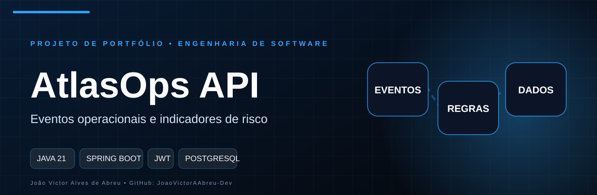

<p align="center">
  
</p>

# AtlasOps API

API backend para acompanhar operacao com eventos, saude operacional e historico.

## Objetivo
Dar visibilidade a eventos operacionais e consolidar indicadores que ajudam a identificar risco, criticidade e deterioracao do fluxo.

## Problema atendido
- eventos operacionais ficam espalhados
- a saude do fluxo nao e visivel em tempo util
- criticidade e risco sao dificeis de acompanhar
- auditoria de operacao vira trabalho manual

## Escopo funcional
- autenticacao com JWT
- cadastro e listagem de eventos
- resumo de saude operacional
- score de risco
- base para dashboards

## Stack
- Java 21
- Spring Boot
- Spring Security com JWT
- Spring Data JPA
- PostgreSQL em producao
- H2 em testes

## Regras de negocio
- eventos criticos reduzem a saude operacional
- eventos acionaveis aumentam o risco
- o dashboard consolida volume, criticidade e score

## Credenciais de demo
- email: `demo@atlasops.dev`
- senha: `atlas123`

## Variaveis de ambiente
- `DATABASE_URL`
- `DATABASE_USERNAME`
- `DATABASE_PASSWORD`
- `JWT_SECRET`
- `JWT_EXPIRATION_MINUTES`

## Como executar
1. suba o PostgreSQL com `docker compose up -d`
2. configure as variaveis de ambiente
3. execute `mvn spring-boot:run`

## Como testar
```bash
mvn test
```

## Endpoints principais
- `GET /api/health`
- `POST /api/auth/login`
- `GET /api/events`
- `POST /api/events`
- `GET /api/dashboard`

## Estrutura do projeto
```text
src/main/java/com/jv/opsinsight
  auth/
  config/
  dashboard/
  exception/
  ops/
  security/
  user/
```

## Decisoes tecnicas
- controllers finos
- regras concentradas em services
- DTOs para entrada e saida
- tratamento centralizado de erros
- persistencia relacional com UUID
- rotas protegidas por JWT

## Evolucao prevista
- categorias de evento
- responsavel por evento
- historico de transicao de estado
- indicadores por janela de tempo
